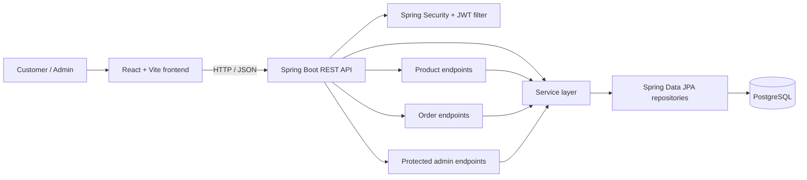

# Mistvale Tea Co. 🍃

A full-stack tea e-commerce application built with **React, Spring Boot, and PostgreSQL**. Mistvale combines a nature-inspired storefront with backend workflows for product management, checkout, inventory validation, order tracking, and protected administration.

> **Project status:** Portfolio project in active development. Automated test coverage is currently limited to a Spring application-context test; additional service and security tests are planned.

## Highlights

- Browse tea products, search, filter by category, and sort the collection.
- View product details and manage a persistent shopping cart.
- Apply the `WELCOME10` coupon when its eligibility rules are met.
- Validate checkout information and place orders.
- Calculate prices, discounts, shipping, and totals on the backend rather than trusting client-submitted prices.
- Check inventory and deduct stock as part of order placement.
- Track an order using its order ID and tracking token.
- Sign in to the admin area using JWT authentication.
- Manage products and review orders; update order statuses through protected endpoints.
- Handle API errors through centralized backend exception handling.

## Technology stack

| Area | Technologies |
|---|---|
| Frontend | React 19, Vite, JavaScript, CSS |
| Backend | Java 25, Spring Boot 4.1.1, Spring MVC |
| Security | Spring Security, JWT (JJWT), BCrypt password hashing |
| Persistence | Spring Data JPA, Hibernate |
| Database | PostgreSQL |
| Validation | Jakarta Bean Validation |
| Build tools | npm, Maven Wrapper |

## Architecture



More detail is available in [`docs/architecture.md`](docs/architecture.md).

## Repository layout

```text
tea-shop/
├── frontend/
│   ├── public/
│   └── src/
│       ├── components/
│       ├── context/
│       └── data/
├── backend/
│   ├── src/main/java/com/mistvale/backend/
│   │   ├── config/
│   │   ├── controller/
│   │   ├── dto/
│   │   ├── entity/
│   │   ├── exception/
│   │   ├── repository/
│   │   ├── security/
│   │   └── service/
│   └── src/test/
├── docs/
│   ├── architecture.md
│   └── screenshots/
└── README.md
```

## Run locally

### Prerequisites

- Git
- Node.js and npm compatible with the installed Vite version
- JDK 25
- PostgreSQL
- A database named `mistvale`

### 1. Configure backend environment variables

The backend reads secrets from environment variables. **Do not commit real credentials or `.env` files.**

Set these variables in your terminal or IDE run configuration:

| Variable | Purpose | Example / guidance |
|---|---|---|
| `DB_URL` | PostgreSQL JDBC URL | `jdbc:postgresql://localhost:5432/mistvale` |
| `DB_USERNAME` | Database user | Your local PostgreSQL user |
| `DB_PASSWORD` | Database password | Your local PostgreSQL password |
| `MISTVALE_ADMIN_USERNAME` | Admin login username | Choose a username |
| `MISTVALE_ADMIN_PASSWORD` | Admin login password | Use a strong, unique password |
| `MISTVALE_JWT_SECRET` | Signing key for JWTs | Generate a new Base64-encoded secret with at least 32 random bytes |

Generate a JWT secret locally with:

```bash
openssl rand -base64 32
```

Keep the generated value private. The JWT library/configuration expects a Base64-encoded signing key. Changing this secret invalidates previously issued tokens.

The backend configuration uses `DB_URL` with a local JDBC URL as its default if `DB_URL` is not set. Set `DB_USERNAME` and `DB_PASSWORD` explicitly.

### 2. Start the backend

From the repository root:

```bash
cd backend
```

On Windows:

```powershell
.\mvnw.cmd spring-boot:run
```

On macOS/Linux:

```bash
./mvnw spring-boot:run
```

The API runs on `http://localhost:8080` by default. Confirm your environment variables are set before starting the application.

### 3. Start the frontend

Open another terminal:

```bash
cd frontend
npm install
npm run dev
```

Vite normally serves the frontend at `http://localhost:5173`. The current backend CORS configuration permits that development origin.

### 4. Build and lint the frontend

From `frontend/`:

```bash
npm run build
npm run lint
```

### 5. Run backend tests

From `backend/`:

```bash
./mvnw test
```

On Windows, use `.\mvnw.cmd test`.

> The project currently contains a basic application-context test. Do not interpret a successful test run as comprehensive business-logic or security coverage.

## API overview

Base URL: `http://localhost:8080`

| Method | Endpoint | Access | Description |
|---|---|---|---|
| `POST` | `/api/auth/login` | Public | Authenticate the configured admin and receive a JWT |
| `GET` | `/api/products` | Public | List products |
| `GET` | `/api/products/{id}` | Public | Retrieve one product |
| `POST` | `/api/products` | Admin | Create a product |
| `PUT` | `/api/products/{id}` | Admin | Update a product |
| `DELETE` | `/api/products/{id}` | Admin | Delete a product |
| `POST` | `/api/orders` | Public checkout | Create an order |
| `GET` | `/api/orders/{id}?token={trackingToken}` | Tracking token required | Retrieve tracking details for an order |
| `GET` | `/api/admin/orders` | Admin | List orders for administration |
| `PATCH` | `/api/admin/orders/{id}/status` | Admin | Update an order's status |

Admin endpoints require a valid JWT in the `Authorization: Bearer <token>` header. Public order tracking requires both the order ID and its tracking token. Avoid sharing tracking tokens or real customer data in screenshots, demonstrations, or public issue reports.

## Checkout rules implemented by the backend

- Product prices are read from the database; the client does not determine the authoritative price.
- A product can be ordered in a quantity of up to five per order.
- The backend checks stock and updates inventory as part of order creation.
- Duplicate product IDs in a single order are rejected.
- `WELCOME10` is the supported coupon code. It requires a minimum subtotal of ₹399, excludes gift products from the discount-eligible subtotal, and caps the discount at ₹150.
- Shipping is ₹49 below the ₹599 discounted-subtotal threshold; otherwise shipping is free.

These rules reflect the current implementation and may change as the project evolves.

## Data model

- **Product** stores the product catalogue, category, price, stock, image, description, rating, and review information.
- **Order** stores customer and delivery details, totals, status, creation time, and a unique tracking token.
- **OrderItem** stores a snapshot of each purchased product's ID, name, price, and quantity and belongs to one order.

An order has multiple order items. Order items retain product details at purchase time, so an order does not depend on the product's current name or price for its line-item snapshot.

## Screenshots

Add screenshots captured from your running application to `docs/screenshots/`, then uncomment or update the image references below.

Suggested screenshots:
- Storefront and product catalogue
- Product details or quick view
- Cart and checkout
- Order tracking
- Admin dashboard and order status management

<!-- Example once the image exists:

-->

Do not include real customer names, addresses, phone numbers, emails, passwords, access tokens, or tracking tokens in screenshots.

## Security notes

- Database credentials, admin credentials, and JWT signing secrets must be supplied through environment variables.
- Keep `.env`, local environment files, and secret-bearing configuration out of Git.
- Rotate any credential that has ever been committed to a public repository.
- Admin passwords are hashed with BCrypt for authentication.
- The API uses stateless JWT authentication for protected admin operations.
- The current CORS configuration is intended for local development (`http://localhost:5173`); update it deliberately for any deployment.
- Before production use, review TLS/HTTPS, secret management, logging, authorization, rate limiting, database migration strategy, and automated security tests.

## Current testing status and next steps

The repository has a basic Spring Boot context-load test. Recommended next additions:

1. Unit tests for coupon eligibility, discount and shipping calculations.
2. Order-service tests for invalid product IDs, duplicate items, quantity limits, and insufficient stock.
3. Security tests for missing, malformed, expired, and valid JWTs.
4. Authorization tests proving that non-admin requests cannot mutate products or access admin order endpoints.
5. Integration tests for successful checkout and order tracking.

## License

No license is declared in this repository yet. Add a `LICENSE` file if you intend to grant others permission to reuse the project.
