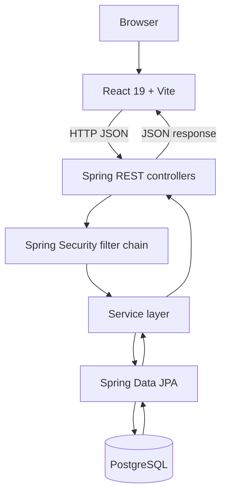
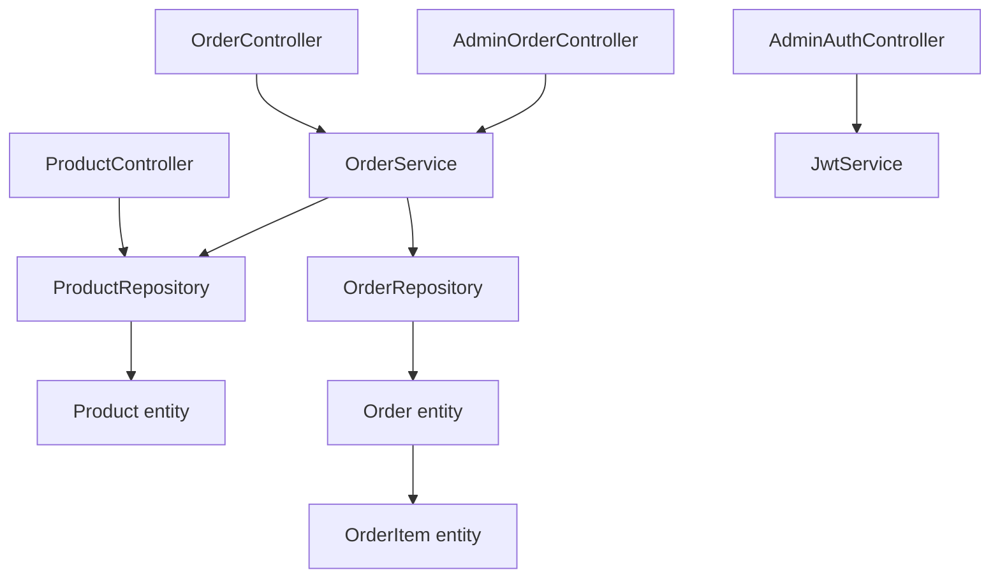
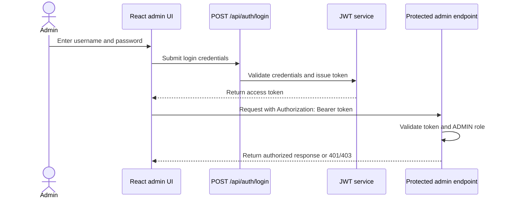
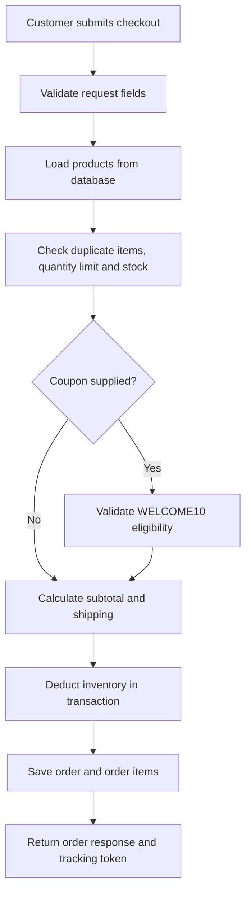
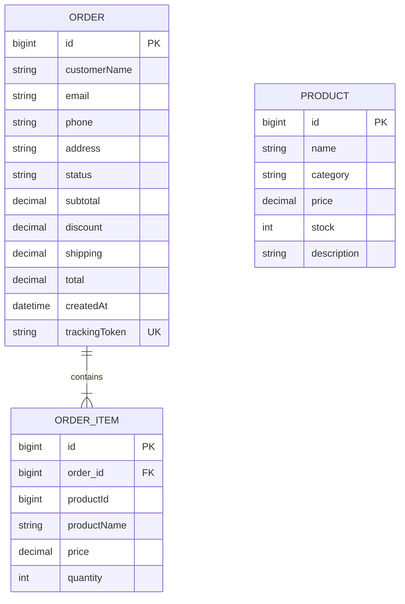

# Mistvale Tea Co. Architecture

## 1. High-level request flow

## 2. Main backend layers

## 3. JWT admin authentication

## 4. Checkout flow

## 5. Entity relationships

**Note:** `OrderItem` stores a product ID and a snapshot of the product's name and price. The current entity model does not declare a JPA relationship from `OrderItem` to `Product`; its JPA relationship is to `Order`.

## Important implementation notes

- The application uses stateless Spring Security with a JWT authentication filter.
- The configured admin user is created from environment-provided credentials and held in an in-memory user details manager. Admin accounts are not currently persisted in a database table.
- The current CORS configuration allows `http://localhost:5173`, which is suitable for local development.
- Inventory and order creation are handled in a transactional service method; the product repository includes a locked product lookup for checkout.
- These diagrams document the uploaded source snapshot. Update them when the implementation changes.
